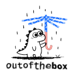

<div align="center">

<picture>
  <source media="(prefers-color-scheme: dark)" srcset="assets/outofthebox-icon-dark.svg">
  
</picture>

# Out of the Box: Relentless Testing for AI Agents

### A rulebook that makes an AI agent keep asking "and what if...?" until nothing new turns up.

**A discipline, not a test framework.** It does not pick your tools. It decides what you point them at, and it does not let the agent stop early.

**[Guide](GUIDE.md) · [Prompts](PROMPTS.md) · [Example hunt](examples/hunt-001-2026-10-25.md) · [Research](skills/outofthebox/references/research.md) · [Roadmap](ROADMAP.md)**

[Before and after](#before-and-after) · [Install](#install) · [What it does](#what-it-does) · [Skills](#skills) · [Scripts and YAML](#scripts-and-yaml) · [FAQ](#faq)

<code>npx @altamisatmaja/outofthebox</code>

</div>

---

## Before and after

The same task given to an agent twice, on a fictional concert ticket store: "buyers can now gift a ticket to a friend by email; check it works."

### Without outofthebox

```
Added the "gift this ticket" button and a test for it.
Test passes. Looks good, ready to ship.
```

One test, the happy path, no evidence, and no word on what was not tried.

### With outofthebox

```
outofthebox active: during (project).

Before I test, here is what could break:
1. The buyer opens the recipient's claim link while signed in. Can the buyer
   claim their own gift, and does the recipient's link then die?
2. The recipient claims twice from two devices at once: one ticket or two?
3. The entry QR code: is it visible before the gift is claimed?
4. Three instalments of 100.00: do 33.34 + 33.33 + 33.33 add up?
5. The service fee: charged once per order, or again for each gift?
6. A payment confirmation that arrives after the order expired.
7. The same confirmation delivered twice.
8. The gift email in the recipient's language, not the buyer's.
9. Phone width: does the sticky bar cover the claim button?
10. Gifts created by the previous version: who owns them now?

Round 1: 1, 3 and 5 reproduced. Each check failed on the old code first:
  "expected owner recipient@example.test, got buyer@example.test".
Fixed. 2, 4, 6, 7 pass. 10: 3 local rows repaired.
Round 2 (what the fix made possible): ... nothing new.

Full suite 412/412, API 58/58. Driven in the browser as both people.
Not tested: a real phone (emulated only), production data (needs permission).
```

The second agent found a bug that handed the ticket to the wrong person, and proved it with a check that failed before the fix.

---

## Install

outofthebox ships as standard agent skills: one folder per skill, each holding a `SKILL.md`. Pick the route for the agent you use. [GUIDE.md](GUIDE.md) walks through each one, with update and removal.

### The installer (recommended)

One command, then answer the prompts. It asks which skills, where (this project or everywhere), and which agents, then copies the folders and writes the pointer that loads outofthebox every session. No dependencies, no network.

```
npx @altamisatmaja/outofthebox
```

Without prompts:

```
npx @altamisatmaja/outofthebox --yes
npx @altamisatmaja/outofthebox --skills outofthebox,outofthebox-qa --agents claude,cursor
npx @altamisatmaja/outofthebox --global
```

### Claude Code: plugin

```
/plugin marketplace add https://github.com/altamisatmaja/outofthebox
/plugin install outofthebox@outofthebox
```

### Codex: plugin

```
codex plugin marketplace add altamisatmaja/outofthebox
codex plugin add outofthebox@outofthebox
```

### Cursor: plugin

```
agent plugin marketplace add https://github.com/altamisatmaja/outofthebox
```

Then open Customize, find outofthebox, and select Install.

### Kimi Code: plugin

```
/plugins install https://github.com/altamisatmaja/outofthebox
```

### Cline: plugin

```
cline plugin install https://github.com/altamisatmaja/outofthebox.git
```

This covers the Cline CLI. For the VS Code or JetBrains extension, use the installer.

### Oh My Pi: plugin

```
omp plugin marketplace add altamisatmaja/outofthebox
omp plugin install outofthebox@outofthebox
```

### Pi: package

```
pi install git:github.com/altamisatmaja/outofthebox
```

### The single file

[`outofthebox.md`](outofthebox.md) on its own is the core rules, the atlas and the heuristics in one file. Paste it into any chat window or drop it next to your project.

```
curl -o outofthebox.md https://raw.githubusercontent.com/altamisatmaja/outofthebox/main/outofthebox.md
```

---

## What it does

- **The hunt loop.** Map, chatter (ten or more concrete cases, out loud), reproduce, pin (a check that fails on the old version), fix or file, run everything, next round. It stops only when a full round finds nothing new.
- **16 rules (O-01 to O-16) in three tiers.** Hard Gate (never test on real data, never touch production, never report a guess, never weaken a check, leave nothing behind), Must Probe, and Quality Locks.
- **A Delivery Gate.** A PASS/FAIL report with evidence for each line, run before anything is handed over.
- **An edge case atlas.** Nine axes (who, how much, when, what state, where, which input, how many, what else changes, what the user will do), each with a real bug, plus domain packs from payments to robotics to documents.
- **Heuristics.** Boundaries, pairwise, metamorphic relations, exploratory tours, what to vary, how to judge a result, personas.
- **Research.** Each rule rests on a journal or conference study (oracle problem, combinatorial faults, flaky tests, error handling failures, concurrency bugs, mutation testing). See [research.md](skills/outofthebox/references/research.md).
- **Ranking that never moves.** Money and data loss, then security and privacy, then broken flows, then wording and looks.

It works in any field: code, data, mobile, hardware, documents, processes.

---

## Skills

| Skill | Covers | Pick it for |
|---|---|---|
| `outofthebox` | The core: loop, rules, modes, Delivery Gate, atlas, heuristics, research | Everything. Always loaded |
| `outofthebox-dev` | Regression checks proven on the old code, a builder's unexpected list, fixing the cause and the data | Building or fixing |
| `outofthebox-qa` | QA flows (Markdown or YAML), scripted plus exploratory cases, bug reports, retest | QA passes and release checks |
| `outofthebox-ui` | Every state, width, language and viewer; reading the screen literally | Screens and flows |
| `outofthebox-api` | Contracts, every door, provider responses, webhooks, retries | Endpoints and integrations |
| `outofthebox-data` | Migrations, imports, pipelines, damage already done | Schema changes and data jobs |
| `outofthebox-security` | Actor by action matrix, inferred ownership, links as credentials, privacy | Sharing, money, personal data |
| `outofthebox-auth` | Every door into an account, links and codes, sessions, tokens, roles | Login and account changes |
| `outofthebox-flow` | States and moves, invariants, every actor's journey, money that balances | Orders, bookings, payments, approvals |
| `outofthebox-responsive` | Every width, breakpoint edges, zoom, orientation, keyboard, real devices | Screens used on phones and desktops |
| `outofthebox-infra` | Defensive self audit: forgotten assets, secrets, debug, storage, network, backups, logs | Before a release or after an infra change |
| `outofthebox-a11y` | Keyboard only, screen readers, zoom, contrast, target size, WCAG 2.2 AA | Anything people see or touch |
| `outofthebox-i18n` | Pseudo locale, missing keys, plurals, text growth, RTL, local formats, time zones | More than one language or region |
| `outofthebox-mobile` | Interruptions, process death, permissions, networks, push, deep links, store updates | Mobile apps and mobile web |
| `outofthebox-ai` | Contract, golden set, grading by meaning, repeated runs, tool calls, regressions, cost | Chatbots, assistants, RAG, agents |
| `outofthebox-docs` | Claims, numbers, steps, links, spreadsheet formulas, models, decks, processes | Work that is not code |
| `outofthebox-redblue` | Rules of engagement, threat model, abuse cases, then detect, alert, respond | Security reviews and incident readiness |

Security skills are defensive and for systems you own, in a test environment, with written permission. Install one, several, or the core alone. Concern skills cite the core rules by number and never copy them.

---

## Usage modes

The agent asks at the start of a session unless a mode is already set. Both modes end with a report you can check.

- **During**: it hunts while it builds or tests, and does not hand over until the Delivery Gate passes.
- **After**: it audits finished work into `outofthebox/hunt-NNN-YYYY-MM-DD.md`. You pick which numbers to fix; nothing else is touched.

Set it once for every project:

```
npx @altamisatmaja/outofthebox --mode during
```

Or for one project, with a line in `CLAUDE.md` or `AGENTS.md`:

```
outofthebox: during
```

A mode asked for in the chat always wins for that session.

---

## Scripts and YAML

| File | What it does |
|---|---|
| `skills/outofthebox-qa/templates/qa-flow.yaml` | A QA flow as data: actors, steps, rules, packs, risks |
| `skills/outofthebox/references/atlas.yaml` | The atlas as data, with an impact rank per question |
| `skills/outofthebox-qa/scripts/expand-flow.mjs` | Crosses a flow's steps with the atlas and prints a ranked case table |
| `skills/outofthebox/scripts/yaml-lite.mjs` | A small YAML reader, so the scripts run with no install |
| `scripts/check-repo.mjs` | Versions in sync, names match folders, cited rules exist, links resolve |
| `scripts/build-single.mjs` | Rebuilds `outofthebox.md` from the skills |
| `scripts/bump-version.mjs` | Sets one version in every manifest |

```
node skills/outofthebox-qa/scripts/expand-flow.mjs my-flow.yaml > cases.md
```

The rows are prompts, not cases. The agent rewrites each into a concrete case or deletes it with a reason.

---

## Using it as a developer

Ask the agent to build or fix something. With `outofthebox-dev` it first checks where the test suite writes (a suite that resets tables on a development database is a stop), then for every risk it writes a check, runs it on the old code to watch it fail for the right reason, fixes, and runs the whole suite. Hand it a QA flow as the acceptance criteria.

## Using it as QA

Fill in [`qa-flow.md`](skills/outofthebox-qa/templates/qa-flow.md) or [`qa-flow.yaml`](skills/outofthebox-qa/templates/qa-flow.yaml) and give it to the agent with `outofthebox-qa`. It asks about anything marked unknown, expands every step into scripted and unexpected cases, runs them with evidence, and files each bug with [`bug-report.md`](skills/outofthebox-qa/templates/bug-report.md).

---

## FAQ

**Is it a test framework?** No. Keep your framework. outofthebox decides what to point it at and when the agent may stop.

**Does it only work for code?** No. The loop and the atlas work for data, mobile, hardware, documents and processes. The documents pack covers claims, numbers, steps and links.

**Will the agent talk a lot?** Yes, on purpose. It names every case it thinks of before testing. Talking without naming a concrete case is against the rules.

**Which agents does it work with?** Claude Code, Codex, Cursor, Gemini CLI, Cline, Kimi Code, Oh My Pi, Pi, and anything that reads `AGENTS.md` (Amp, OpenCode, GitHub Copilot).

**What is a skill?** A folder with a `SKILL.md`. Skills cite the core rules by number, so adding one never changes the core.

---

> "Done" means a full round found nothing new,
> every check failed on the old version first,
> and the report says what was not tested.

## License

MIT: [LICENSE](LICENSE)
